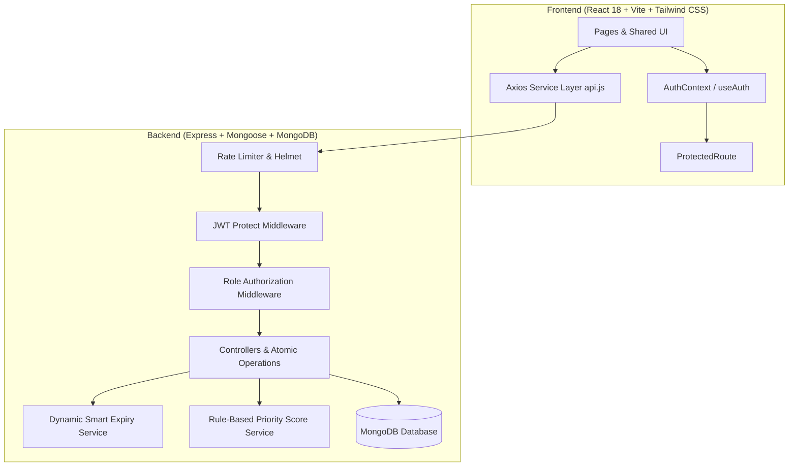

# ShareBite – Food Redistribution Platform: System Walkthrough

ShareBite is a full-stack MERN application that connects food donors (hotels, caterers, restaurants, and individuals) with verified NGOs to rescue surplus edible food before it goes to waste.

---

## 1. System Architecture Overview



---

## 2. Completed Milestones

### Backend Modules (Prompts 01 – 11)

| Module | Features & Guarantees | Status |
| :--- | :--- | :---: |
| **01 Setup** | Express, Helmet, CORS, Rate Limiter, Centralized Error Handling, MongoDB Mongoose connection | ✅ |
| **02 User Model** | Mongoose schema, bcrypt password hashing with `select: false`, verificationStatus enum | ✅ |
| **03 Authentication** | Register (blocks public admin), Login, Get Current User (`/api/auth/me`), Logout | ✅ |
| **04 Donation Model** | Documented schema with 5 indexes including `{ status: 1, pickupDeadline: 1 }` | ✅ |
| **05 Donation CRUD** | Paginated listing, Donor ownership enforcement, update and cancel controls | ✅ |
| **06 NGO Verification** | CLI `npm run seed:admin`, Admin user list, Verify/Reject PATCH endpoint | ✅ |
| **07 Atomic Claim** | Atomic `findOneAndUpdate({ _id, status: 'AVAILABLE' })`, HTTP 409 on race conditions | ✅ |
| **08 Complete Pickup** | Restricted to the claiming NGO; updates status to `COMPLETED` | ✅ |
| **09 Smart Expiry** | Pure dynamic calculation (`Fresh / Pickup Soon / Expired`); never stored stale in DB | ✅ |
| **10 Priority Score** | Rule-based 0–100 score (Time 75%, Quantity 25%); dynamic, not persisted in DB | ✅ |
| **11 Backend Tests** | 13 test suites covering all security and business rules; **122 / 122 tests passed** | ✅ |

### Frontend Modules (Prompts 01 – 08)

| Module | Features & Guarantees | Status |
| :--- | :--- | :---: |
| **01 Setup** | React 18, Vite, Tailwind CSS, Axios client with interceptors, Layout foundation | ✅ |
| **02 Auth State** | `AuthContext`, session restoration, `ProtectedRoute`, `LoginPage`, `RegisterPage` | ✅ |
| **03 Shared UI** | Reusable `Button`, `Input`, `Select`, `Modal`, `ConfirmDialog`, `LoadingSpinner`, `EmptyState`, `ErrorState`, `StatusBadge`, `DonationCard` | ✅ |
| **04 Donor Dashboard** | Summary metrics, My Donations list, Create/Edit `DonationFormModal`, Cancel dialog | ✅ |
| **05 NGO Dashboard** | Available feed sorted by Priority Score, Details modal, Atomic claim, Complete pickup | ✅ |
| **06 Admin Dashboard** | User management, Pending NGO verification queue with Verify/Reject, Platform metrics | ✅ |
| **07 Expiry & Priority UI** | Standardized `Fresh / Pickup Soon / Expired` and `Normal / High / Urgent` badges | ✅ |
| **08 UX Polish** | Mobile hamburger navigation, double-submit guards, session expiration cleanup | ✅ |

---

## 3. Key Architectural Boundaries Verified

1. **Security & Authorization**:
   * Frontend `ProtectedRoute` provides clean UX and routing protection.
   * The backend JWT middleware and role validators (`authorize('donor')`, `authorize('ngo')`, `authorize('admin')`) remain the real enforcement boundary.
2. **Atomic Claim Safety**:
   * MongoDB document locking ensures that two concurrent NGO claim requests cannot both succeed; one receives HTTP 200, the other receives HTTP 409 Conflict.
3. **Pure Derived Values**:
   * Smart Expiry and Priority Score are calculated dynamically on the backend and consumed directly by React components. No duplicate threshold formulas exist on the client.
4. **Restricted Registration**:
   * Public registration exposes only `donor` and `ngo`. Admins are manually seeded and verified.

---

## 4. How to Run the Application

### Running the Backend Server
```bash
cd server
npm install
npm run seed:admin      # Seed admin user if not already seeded
npm run dev             # Starts Express server on http://localhost:5000
```

### Running Backend Tests
```bash
cd server
npm test                # Executes the 122-assertion backend test suite
```

### Running the Frontend Client
```bash
cd client
npm install
npm run dev             # Starts Vite development server on http://localhost:5173
```
